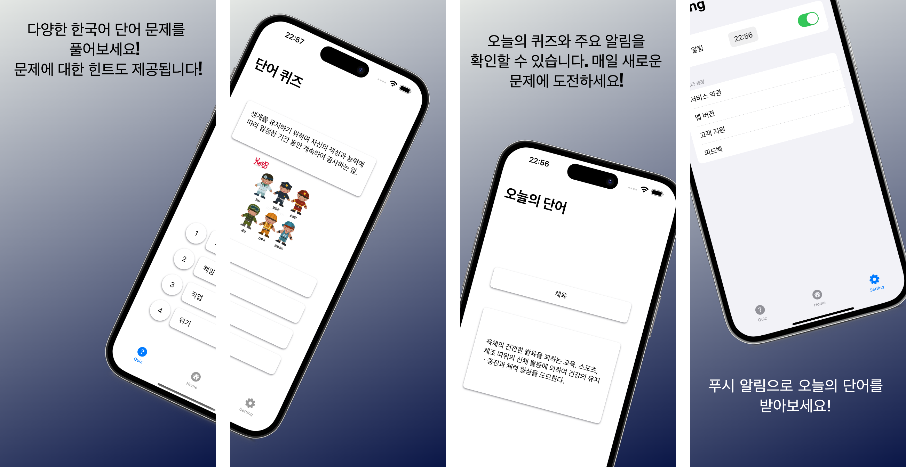

# WordQuizDaily


**WordQuizDaily** is a SwiftUI vocabulary learning app that helps learners review one Korean word every day, solve short quizzes, and keep a steady study rhythm through reminders.

The project is built as a real App Store product, with localized resources, widget support, push notification integration, and a local learning-word model designed to keep the core study flow available even when remote services are unavailable.

[View App Store](https://apps.apple.com/kr/app/%EC%9A%B0%EB%A6%AC%EB%A7%90-%EB%8B%A8%EC%96%B4-%ED%80%B4%EC%A6%88-korean-words-quiz/id6505052767) · [Product Page](https://jjwon2149.github.io/WordQuizDaily/) · [Project Docs](docs/README.md)



## Why This Project Stands Out

- **Product-minded iOS implementation**: today word, quiz, reminder, widget, and App Store presentation are treated as one user journey.
- **Offline-first learning data**: the MVP learning content is stored locally so definitions, examples, romanization, and feedback can load without depending on a server.
- **Localized learner experience**: Korean, English, and Japanese resources support a broader learner audience.
- **Maintainable SwiftUI structure**: screens, view models, models, network clients, services, helpers, and localization resources are separated by responsibility.
- **Recruiter-friendly documentation**: product scope, architecture notes, QA checklist, and implementation boundaries are documented for reviewers.

## Core Features

| Area | Description |
| --- | --- |
| Today Word | Shows a daily Korean word with learner-friendly definition, romanization, part of speech, difficulty, and example sentence. |
| Quiz | Generates multiple-choice quizzes from the local learning-word repository and gives answer feedback after submission. |
| Feedback | Explains the correct answer with meaning, example, romanization, difficulty, and review hints. |
| Review | Saves mistakes on this device and offers short review sessions; two consecutive later correct answers clear a mistake. |
| Levels | Offers beginner, intermediate, advanced, and all-level regular quizzes with same-level and same-part-of-speech choices. |
| Reminder | Schedules localized study reminders locally; Firebase Cloud Messaging receiving remains supported. |
| Widget | Provides a home-screen widget target for quick daily-word exposure. |
| Localization | Maintains Korean, English, and Japanese resource files for app labels and learning flow text. |

## Tech Stack

- **Language/UI**: Swift, SwiftUI
- **Architecture**: MVVM-style screen state with `ObservableObject` view models
- **Data**: Shared `LearningCore` Swift package, bundled word JSON, and versioned local learning records
- **Networking/Media**: Naver image search integration, Kingfisher image loading
- **Notifications/Analytics**: Firebase Analytics, Firebase Messaging
- **Monetization**: Google Mobile Ads banner integration
- **Distribution Assets**: App Store screenshots and GitHub Pages product page

## Project Structure

```text
WordQuizDaily/
├── WordQuizDaily/
│   ├── WordQuizDaily/              # Main SwiftUI app target
│   │   ├── Models/                 # Learning words, Naver response models
│   │   ├── Views/                  # Home, quiz, settings, AdMob views
│   │   ├── Network/                # Naver API clients
│   │   ├── Services/               # FCM service and notification manager
│   │   ├── Helpers/                # Localization and formatting helpers
│   │   └── Resources/Localizations # ko, en, ja strings
│   ├── WordQuizWidget/             # Widget extension
│   └── NotificationServiceExtension/
├── AppStoreScreenshots/            # Store-ready screenshots
├── docs/                           # Product page and project documentation
└── tools/                          # Screenshot framing utility
```

## Getting Started

### Requirements

- macOS with Xcode 16 or newer for the Swift 6 package tools (current verification environment: Xcode 27)
- iOS 17.0+ deployment target for the main app
- CocoaPods if you want to install pod-based dependencies
- Firebase configuration file for local notification/analytics builds

### Local Setup

1. Clone the repository.
2. Run `pod install` inside the `WordQuizDaily/` directory if the `Pods/` support files are not present locally.
3. Copy `WordQuizDaily/WordQuizDaily/Config.xcconfig.example` to `WordQuizDaily/WordQuizDaily/Config.xcconfig` and fill in local API/ad identifiers.
4. Add a valid `GoogleService-Info.plist` to the app target when building Firebase-enabled flows.
5. Open `WordQuizDaily/WordQuizDaily.xcworkspace` in Xcode.
6. Confirm signing settings for the app, widget, and notification extension targets.
7. Build and run the `WordQuizDaily` scheme on an iOS simulator or device.

`GoogleService-Info.plist` and local `.xcconfig` files are intentionally ignored by Git because they contain environment-specific configuration.

## Documentation

- [Documentation Index](docs/README.md)
- [Architecture Overview](docs/architecture.md)
- [Foreign Learner MVP Scope](docs/foreign-learner-mvp.md)
- [Current Structure Analysis](docs/foreign-learner-mvp-analysis.md)
- [Reviewer QA Checklist](docs/qa/foreign-learner-mvp-checklist.md)

## Product Direction

The current development milestone adds learning continuity for foreign Korean learners. The local catalog contains 66 words across three difficulty groups and nouns, verbs, and adjectives. Difficulty is an app grouping, not certified TOPIK alignment. The learning content includes:

- English meaning
- Easy Korean definition
- Romanization
- Part of speech
- Difficulty
- Korean example sentence
- English example translation
- Incorrect-answer feedback

This keeps the learning experience clear, reviewable, and resilient without requiring a new backend during the MVP phase.

The next-release changes are under verification, not a claim about the live App Store version. See the [implementation plan](docs/next-release-plan.md), [verification record](docs/qa/next-release-verification.md), and [content review](docs/qa/learning-content-review.md). Run core logic tests with `swift test --package-path WordQuizDaily/Packages/LearningCore`.

## Privacy

WordQuizDaily does not require account creation for the core learning flow. The MVP learning content is local-first and does not depend on server-side personal study history.

## Contact

- Developer: Jongwon Jeong
- Email: jjwon2149@gmail.com

## Commit Convention

- `feat`: new feature
- `fix`: bug fix
- `docs`: documentation update
- `style`: formatting-only change
- `refactor`: code refactor
- `test`: test update
- `chore`: build or maintenance task

## Banner placement (2026-10-12)

Home and Settings only. Quiz, review/completion, permission prompts, terms/support sheets, and widgets remain ad-free. Each allowed screen owns one standard SDK 320×50 banner in its bottom safe-area inset above the tab bar; no root TabView banner. Center within the available safe-area width; omit the banner below 320pt rather than scale or crop it. Loading, no-fill and failure leave no slot or gap. A visible banner has an 8pt separator from content. Preserve existing consent, configuration and request guards.

QA: use test ads or a request-free layout mock. Check 320pt/375pt/wide and landscape widths, tab switching, scrolling, detail navigation and sheets, loading/failure/no-ad states, and large text. Do not click live ads.
